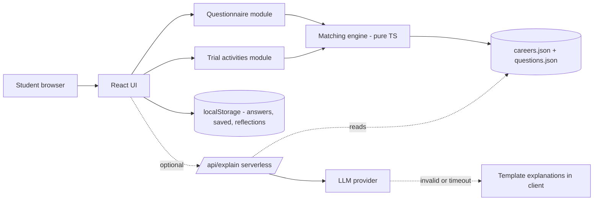

# Career Discovery Platform – Hackathon Master Blueprint

*AI-assisted career exploration for Class 9–12 students in India · single source of truth for research, build, test, deploy and demo*

## How to read this document

This blueprint has four parts. **Part 1** (this part): decisions, research, users, features. **Part 2**: product spec, questionnaire, dataset, matching algorithm, AI guardrails, architecture. **Part 3**: design system, signature activities, team plan, schedule, testing, risks, deployment. **Part 4**: coding-agent prompts, demo script, judge Q&A, roadmap.

**Honesty labels used throughout**

- **\[SOURCE\]** – retrieved from a web source during preparation; the URL is given. Many sources are company or press-release material and are marked as such.
- **\[BACKGROUND\]** – established frameworks or facts from general knowledge, *not* re-verified here. Verify before citing to judges.
- **\[ASSUMPTION\]** – a design choice we made. Not scientifically validated.
- **\[TO VERIFY\]** – an education fact (exam, eligibility, pathway) the team must confirm against the official site and stamp with a date before it ships. Nothing in the sample data should be treated as verified until that is done.

Research was run on 24 Oct 2026 with a limited number of searches. Several statistics found online come from vendors' own marketing; they are flagged and **must not** be used as pitch claims.

## 0. Executive summary: the ten decisions

| # | Decision | Why |
| --- | --- | --- |
| 1 | Build a **deterministic, explainable recommender** (no custom ML) | Transparent, testable in hours, honest to judges |
| 2 | AI is an **optional layer**: plain-language explanations and Q&A grounded in our career records | Core journey works with no API key |
| 3 | **Signature feature = Try Before You Choose**, with a visible “what changed after your reflection” re-rank | No quiz or chatbot competitor we found does experience-informed re-ranking in-app |
| 4 | Interest model = **RIASEC-style six dimensions + subjects + skills-to-grow + openness** | Established framework; simple; explainable |
| 5 | **Show rank bands and “why”, never a percentage match or success probability** | Interest similarity is not aptitude, qualification or future success |
| 6 | **12–15 carefully researched careers** at launch, 2 pathways each, each stamped with sources and last-verified date | Depth and accuracy beat breadth |
| 7 | **No accounts, no names, no database.** Results live in the browser (localStorage) | Users are minors; data minimisation |
| 8 | Stack: **React + Vite + TypeScript + Tailwind**, static JSON data, one tiny serverless function for AI | Deployable in minutes, nothing to run when AI is off |
| 9 | Hindi + English for questionnaire UI only (P2); career content English first | Realistic scope |
| 10 | **Scope freeze at hour 8**, early deploy at hour 4 | Most hackathon failures are integration and deployment failures |

**Suggested names** (check domain and trademark conflicts yourselves; several similar names exist in the market): **Khoj** (Hindi: search, discovery), **Raahi** (traveller), **PathLab** (experiment with paths), **Dishaa Lab**, **TryPath**. Our pick: **FIGUROUT** – signals figuring out paths and trying experiences, works in English and Hindi-speaking contexts, and fits the signature feature.

## 4. Research findings

### 4.1 The real student problem and its root causes

The problem statement you gave is directionally consistent with what Indian education bodies and guidance providers say publicly, but we found **no single authoritative dataset** during this research that quantifies it. Treat prevalence claims as unverified. The plausible root causes, as design hypotheses \[ASSUMPTION unless validated\]:

1. **Awareness gap.** Students know a handful of familiar careers (doctor, engineer, etc.) and little about adjacent or newer ones.
2. **Decision points arrive early.** Stream choice after Class 10 (Science/Commerce/Humanities) is commonly framed as a major turning point; common advice pieces say it should weigh interests, strengths and goals rather than marks or peers alone (e.g. Narayana Schools' guidance blog, https://www.narayanaschools.in/blog/?p=5883 – school marketing content, not research).
3. **Fragmented information.** Career information, exam information and college information sit on different sites with different quality.
4. **Limited counselling capacity.** A 2023 Government of India letter to states on career counselling in secondary and senior secondary schools discusses nominated teachers and counsellors (https://samagra.education.gov.in/docs/guidelines\_brc\_1707.pdf, dated 13 July 2023; only partially readable during our research – **read it fully**). A widely repeated counsellor-shortage statistic traces to iDreamCareer marketing (via YourStory, https://nextjs-prod.yourstory.com/weekender/this-platform-provides-a-one-stop-solution-to-career-guidance-mindler). **Do not quote it** as fact.
5. **Social pressure.** Guidance providers repeatedly name peer-following and marks-driven choices as common mistakes (e.g. Physics Wallah blog, https://www.pw.live/vp-blogs/exams/cbse-10th-second-board-result-2026-whats-next). Again, marketing content.

### 4.2 Credible frameworks and research (background)

These are well-known in career-development literature \[BACKGROUND – verify before presenting as cited research\]:

- **Holland's RIASEC model** (Realistic, Investigative, Artistic, Social, Enterprising, Conventional): interests and occupations can be described on six themes. Widely used, with known criticisms (cross-cultural fit, gender-linked item effects, modest prediction of satisfaction and performance).
- **Social Cognitive Career Theory** (Lent, Brown, Hackett): interests develop through self-efficacy and outcome expectations, which grow through *experiences*. This supports our “try an activity” feature.
- **Career construction / exploration** (Super, Savickas; career-exploration literature): adolescents benefit from structured exploration of self and environment, not one-off “answers”.
- **Implication:** interest inventories are best used to **open options and start conversations**, not to issue verdicts.

**O\*NET Interest Profiler.** The US Department of Labor's O\*NET programme publishes an interest profiler built on RIASEC. A third-party site states it is licensed CC BY 4.0 with attribution (https://jobcannon.io/assessments/onet-interest-profiler?start=true). **\[TO VERIFY at onetcenter.org\]** before reusing any item text. Recommended safe path: write **our own original activity statements** inspired by the six themes, credit RIASEC/Holland as the framework, and never copy items verbatim until the licence is confirmed. Its work-activity item style (concrete tasks, not abstract traits) is a good design idea to borrow.

### 4.3 India's official guidance resources

- **National Career Service (NCS)**, Ministry of Labour and Employment, launched 20 July 2015, portal ncs.gov.in. Official pages describe career counselling, vocational guidance, information on skill courses, Model Career Centres for in-person counselling, a career-information section with job-role information, and a stated focus on counselling and career development (https://labour.gov.in/ncs; https://dge.gov.in/ncs). Its toll-free helpline appears on a third-party page (https://www.bankbazaar.com/government-schemes/national-career-service.html); confirm on ncs.gov.in before displaying it.
- **NCERT** is the national nodal body for school guidance and counselling; Kendriya Vidyalaya pages list NCERT counselling services and “What after Class X and XII” resources (e.g. https://guna.kvs.ac.in/guidance-counselling/). **Action:** find the current NCERT/CBSE publications and link to them directly from career pages.
- **Exam and admission facts** must come from the conducting body's own site (NTA for JEE Main, NEET-UG and CUET-UG; institute sites for design and other entrance tests). \[TO VERIFY for every record.\]

**Design implication:** position the product as a **front door that points to official resources** (NCS, NCERT, exam bodies, school counsellor), not a replacement.

### 4.4 Existing solutions and gaps

All product details below are from public marketing or press material and **not independently verified**.

| Product | Publicly described approach | Source | Strengths | Gaps/opportunity for us |
| --- | --- | --- | --- | --- |
| **Mindler** | Five-dimension assessment (aptitude, interest, personality, EQ, orientation), counsellor support; launched “Nexus” AI platform in Aug 2024 with subject-combination and interdisciplinary recommendations and virtual career simulations (press release) | https://www.theweek.in/wire-updates/business/2024/08/21/dcm11-mindler.html ; psychometric validation paper: https://asiapacificcda.org/Resources/APCDJ/A0006\_1\_01.pdf | Validated assessment, counsellors, scale | Largely paid/gated; reports are assessment-first; we found no public detail of per-recommendation transparency |
| **iDreamCareer** | Career content library, psychometric tools, 1:1 counselling, counsellor certification; self-reported reach | https://yourstory.com/companies/idreamcareer/amp | Content depth, school partnerships | Same – gated; reach claims are self-reported |
| **CareerGuide / Careers360 / similar** | Many tests plus articles on streams after Class 10 | https://careerplanb.co/best-career-counseling-platforms-india/ (listicle, not neutral) | Brand, SEO, breadth | Information-heavy articles; test-then-report flow |
| **NCS portal** | Official career information, counselling booking, job portal | https://labour.gov.in/ncs | Authoritative, free | Not designed as a teen-friendly interactive exploration experience (our judgement; check the portal yourselves) |

**Gaps we can credibly address in a prototype** \[ASSUMPTION – validate by trying competitors yourselves for 30 minutes and screenshotting what you see\]:

1. Transparent, per-career *why* tied to the student's own answers, with a way to challenge it.
2. A free, no-signup, privacy-first flow.
3. Small hands-on **trial activities** that feed back into exploration.
4. Always-visible pointers to official sources with a last-verified date.
5. Stretch recommendations that deliberately introduce unfamiliar careers.

Do **not** claim competitors lack any of these unless you have checked their current product.

### 4.5 Design implications

| Finding | Product decision |
| --- | --- |
| Interest inventories are modest predictors | Present as conversation-starters; no percentages; show uncertainty |
| Experiences shape self-efficacy | Try Before You Choose is central, not decorative |
| Info quality varies and exams change | Every record carries sources, last-verified date and “check official site” CTA |
| Counselling is scarce | Shareable one-page summary for parents/teachers (print/PDF) – P1 |
| Pressure from marks/peers/family | Questions about enjoyment, not marks; “discuss with someone you trust” prompts |
| Minors | No accounts, no names, local storage only |

### 4.6 Unresolved assumptions needing validation

1. Do students find 18 activity questions + 3 short sections acceptable (target ≤ 6 minutes)?
2. Do the six RIASEC-style dimensions generalise to Indian students' lived career awareness?
3. Are our initial career profile weights sensible? (Ask 2–3 teachers or a school counsellor to review the dataset.)
4. Do students understand “bands” better than numbers?
5. Does the trial-activity reflection actually help students decide? (Needs a real study; **make no claim** at the hackathon.)

## 5. Problem definition and users

**Problem statement.** Students in Classes 9–12 in India often choose streams and courses using marks, peer or family expectations and a narrow set of known careers. Reliable information is scattered, and personalised guidance is not equally available to everyone.

**Vision.** A free, private, honest exploration tool that helps a student move from *“I don't know what I like”* to *“here are several directions, here is why they came up, here is what I could try this week, and here is who to talk to.”*

**Value proposition.** *Explore careers through what you enjoy, understand why each one shows up, try a small taste of it, and leave with a realistic next step – without sign-up and without being told what to be.*

### Users and jobs to be done

| User | Job to be done | Current alternatives | Why insufficient |
| --- | --- | --- | --- |
| **Primary: student (Class 9–12)** | “Help me see options I haven't thought about and decide what to look into next” | Friends, family, YouTube, Google, coaching-centre advice, paid assessments, school counsellor if available | Biased, scattered, paid, or hard to access |
| **Secondary: parent/teacher** | “Help me have a useful conversation with this student without pushing” | Own experience, internet articles | Dated or one-size-fits-all |
| **Future: school counsellor** | “Use this as a warm-up before a session” | Paper tools, paid platforms | Post-hackathon only |

### User pain points and stories (selected)

- *As a student, I want questions about things I actually enjoy, so I can answer honestly instead of guessing what is “right”.*
- *As a student, I want to know why a career was suggested, so I can disagree with it.*
- *As a student, I want to try a small task from a career, so I know if it is more than a job title.*
- *As a student, I want to compare two careers side by side, so I can discuss them with my parents.*
- *As a parent, I want to see the exam and course route, so I can support without guessing.*

### Four representative scenarios (illustrative personas, **not** research)

| Persona (fictional) | Situation | How the product helps | What it does *not* do |
| --- | --- | --- | --- |
| **Asha, Class 10** | Likes science; only knows “doctor or engineer” | Shows Biomedical Research, Data Science, Clinical Psychology, UX Design with reasons; trial activity to see what research or design feels like | Tell her which stream to take |
| **Karan, Class 11** | Interests are all over: coding, music, debating | Shows distinct clusters side by side; Compare Lab; highlights the shared threads (e.g. creating + analysing) | Force a single cluster |
| **Meera, Class 10** | Friends all picking Science; unsure herself | Questions are about enjoyment not marks; results include non-Science routes; “talk to someone you trust” prompt | Reinforce peer or family pressure |
| **Imran, Class 12** | Doesn't know his strengths; wants unfamiliar options | Stretch picks from unseen clusters; trial activities; roadmap with entry routes | Claim to measure aptitude |

**Measurable success (prototype)** – functional: a student can finish the journey in ≤ 8 minutes; 100% of displayed recommendations have visible reasons and source links; works fully offline-of-AI. **Aspirational (not claimed at hackathon):** improved confidence in next steps, validated through pilot surveys with student and teacher consent.

## 3 & 10. Feature evaluation and prioritisation

Effort assumes a 3–4 person team with an AI coding agent. Tiers: **P0** essential, **P1** after the core flow works, **P2** optional, **Post** after hackathon.

| # | Feature | Problem & user | Value vs ordinary quiz | How / tech / data | Effort | Key risk | Demo value | Tier |
| --- | --- | --- | --- | --- | --- | --- | --- | --- |
| 1 | **Smart Interest Explorer** | Students can't articulate interests; student | Concrete activity statements, not “are you creative?” | 18 activity items + subjects + skills + openness; React form; JSON questions | M (3h) | Long/invasive | High | **P0** |
| 2 | **Explainable matching** | Black-box scores; student | Shows which answers drove each match; adjustable | Deterministic scorer in TS; career JSON | M (3h) | Misread as prediction | Very high | **P0** |
| 3 | **Career roadmap** | Don't know routes; student, parent | Real pathways with sources and verified date | Per-career `pathways[]`; stepper UI | M (3h incl. research) | Stale facts | High | **P0** (12–15 careers) |
| 4 | **Compare Lab** | Can't weigh options | Side-by-side routes and activities | 2-column view from same JSON | S (1.5h) | Clutter | Medium | **P1** |
| 5 | **Try Before You Choose** | Titles ≠ day-to-day; student | Experience-based, feeds re-rank | 3–5 in-browser activities | M–L (4h for 3) | Seen as a test | Very high | **P0 (1 polished + 2 simple)** |
| 6 | **India-aware guide** | Generic or foreign content | Indian streams, exams, official links | Content work inside the dataset | M (research time) | Wrong exam info | High | **P0** (content) |
| 7 | **Hindi + English** | Language barrier | Reach | i18n JSON for UI strings | M | Poor translation quality | Medium | **P2** (questionnaire only) |
| 8 | **My Exploration Journey** | Lose results | Revisit and track | localStorage; saved list | S (1.5h) | Shared-device privacy | Medium | **P1** |
| 9 | **Parent/counsellor support** | Family conversation | One-page summary | Print stylesheet | S now; large later | Privacy, pressure | Low–Med | **P1 print summary; Post for accounts** |
| 10 | **AI Career Companion** | Follow-up questions | Plain-language help | Serverless LLM call, grounded in records | M (3h) | Hallucination | High if guarded | **P1: “Explain this match / Simplify this pathway” only; full chatbot is Post** |

### Scope rules

- **Most distinctive feature:** Try Before You Choose with the transparent re-rank. It converts the product from “answer a quiz, read a list” to “explore, experience, reflect, update”.
- **Single most important workflow, working by hour 4:** *Questionnaire → scoring → results with reasons → career detail → (deploy).*
- **Scope freeze (hour 8):** nothing new is started after this. If behind schedule at hour 6, drop in this order: Hindi, full AI Companion, Compare Lab polish, Journey tracking, extra activities.
- **Never ship:** dead buttons, fake analytics, invented statistics, placeholder content that looks verified.

### Acceptance criteria by tier

- **P0:** (a) 100% of required questions can be answered or skipped; (b) ≥ 6 careers displayed with ≥ 2 specific reasons each; (c) detail page shows description, pathways, sources, last-verified date; (d) at least one trial activity completes and shows a reflection; (e) AI off → app fully usable; (f) works at 360 px width.
- **P1:** Compare shows 2 careers with aligned rows; saved careers survive refresh; AI explanation appears with fallback text when API is down.
- **P2:** Hindi strings present for every questionnaire screen with no layout breakage.

# PART 2 – Product, Algorithm, AI and Architecture

## 6. Product specification

### 6.1 Journey in one paragraph

A student opens FIGUROUT on a phone, reads a 20-second privacy note (“no name, no account, answers stay on this device”), answers six short activity pages, picks subjects and skills, sees six to eight career cards in three groups (*Strong overlap*, *Good overlap*, *Something different*), each with the answers that drove it. She opens one, reads a plain-language day-in-the-life and the education routes with official links, tries a five-minute activity, reflects, sees how her results shifted, compares two careers, saves three, and leaves with a one-page “things to try and people to talk to” summary.

### 6.2 Screens (all P0 unless marked)

| # | Screen | Purpose | Shows | Primary / secondary actions | Reads / writes |
| --- | --- | --- | --- | --- | --- |
| 1 | **Landing** | Explain value, set honest expectations | One-line promise, 3-step strip, “Start (about 6 min)”, “Not a test, not a prediction” | Start / How it works | none |
| 2 | **Intro & privacy** | Consent-lite and framing | What is collected (answers only, on device), what is not, who to talk to | Continue / Back | writes `session.started` |
| 3 | **Questionnaire** (6 activity pages, subjects, skills, environment, openness) | Capture preferences | 3 activity cards per page with 5-point scale + “Not sure”; progress bar | Next / Back / Skip page | writes `answers` |
| 4 | **Review answers** | Let student correct | Compact summary per section, edit links | See my options / Edit | reads `answers` |
| 5 | **Results** | Present several possibilities with reasons | Grouped career cards, 2 reason chips each, “Why this?”, “Not for me”, bookmark | Open career / Compare (select 2) / Adjust | reads `answers`, `careers.json`; writes `saved`, `dismissed` |
| 6 | **Career detail** | Understand the career | Summary, day-in-the-life, skills, subjects, adjacent careers, sources + last-verified | Try an activity / See pathway / Save | reads one career |
| 7 | **Pathway / roadmap** | Education routes and next steps | Stepper: Class 11–12 subjects → route options → entrance exams (if verified) → skill-building; “Check official site” buttons | Open official link / Back | reads `pathways[]` |
| 8 | **Compare Lab** (P1) | Weigh two careers | Aligned rows: day-to-day, skills, routes, subjects, “what you rated” | Swap career / Save | reads two careers |
| 9 | **Try Before You Choose** | Experience a task | Activity UI, timer-free, one task, reflection | Finish / Skip | writes `reflections` |
| 10 | **Reflection & update** | Close the loop | 3 reflection questions; “what changed” panel showing nudge applied and reason | Update my results / Keep as is | writes `profileNudges` |
| 11 | **My exploration** (P1) | Revisit and plan | Saved careers, tried activities, next-step checklist, print summary | Print / Clear all data | reads/writes localStorage |

### 6.3 State coverage (apply to every screen)

- **Loading:** skeleton cards under 300 ms; the matching engine is synchronous, so loading only appears for the optional AI explanation.
- **Empty:** results page with fewer than 3 answered sections shows “A few more answers give better options” with a button back to the questionnaire.
- **Error:** AI failure shows the templated explanation silently plus a small “plain explanation shown” note; data-load failure shows a retry and a link to NCS.
- **Success:** only after completed trial activities.
- **Mobile:** single-column, 44 px touch targets, sticky bottom action bar.
- **Accessibility:** semantic headings, labelled radio groups, visible focus rings, colour is never the only signal, ≥4.5:1 text contrast, `prefers-reduced-motion` respected, all activities operable by keyboard.

## 7. Questionnaire and matching engine

### 7.1 Dimensions and why they exist

| Dimension | Why | Contribution |
| --- | --- | --- |
| **Activity enjoyment** (6 RIASEC-style themes × 3 items) | Interests tied to concrete activities are easier for teens to answer than traits | Main driver (weight 0.55) |
| **Subject curiosity** (pick up to 3) | Links careers to what is studied; informs stream/subject choice | 0.20 |
| **Skills to grow** (pick up to 3) | Reflects willingness to develop, not just current ability | 0.15 |
| **Working environment** (optional, pick up to 2) | Lab, outdoors, studio, office, with people, remote | 0.10 |
| **Openness to the unfamiliar** (1–5) | Controls how many stretch careers appear | Diversity control, no score |

Weights are **\[ASSUMPTION\]**. They are not validated.

### 7.2 Proposed questionnaire

Prompt on every activity page: *“Imagine you had time and help. How much would you enjoy this?”* Options: 1 Not at all · 2 A little · 3 Okay · 4 Quite a lot · 5 Loved it · *Not sure / skip*. Statements below are original and inspired by the six themes (no third-party item text).

| Theme | Q1 | Q2 | Q3 |
| --- | --- | --- | --- |
| **R** Practical/hands-on | Build, repair or set up something with your hands or tools | Grow plants, care for animals, or work outdoors on a project | Take a gadget apart to see how it works |
| **I** Investigative | Run an experiment and work out why it turned out that way | Look at data or patterns and figure out what they mean | Research a hard question until you find a solid answer |
| **A** Creative | Design a poster, app screen or game character | Write a story, script or song | Make a short video or photo series that shows an idea |
| **S** Helping/teaching | Explain something until a friend finally gets it | Support someone through a tough situation | Plan a small teaching session or activity for younger kids |
| **E** Leading/persuading | Convince others to back an idea or cause | Plan and launch a small project or stall with a budget | Lead a team to reach a goal |
| **C** Organising/detail | Organise information so it is accurate and easy to find | Check numbers or records for mistakes | Plan a schedule or system so things run smoothly |

**Subjects (pick up to 3):** Maths, Physics, Chemistry, Biology, Computer Science, Economics, Languages, Social Science, Art & Design, Business Studies, Psychology. **Skills I'd like to build (pick up to 3):** Coding, Data analysis, Lab skills, Design thinking, Writing, Public speaking, Communication, Leadership, Research methods, Problem solving, Creativity, Teamwork. **Environments (optional, up to 2):** Lab, Outdoors/field, Studio/creative space, Office, Working with people, Flexible/remote. **Openness:** *“How open are you to careers you haven't heard of?”* 1–5.

No marks, no family income, no caste, no gender, no personal identifiers are asked. Length: 18 + 4 taps; target ≤ 6 minutes.

### 7.3 Career dataset

```ts
type Dim = 'R'|'I'|'A'|'S'|'E'|'C';
interface Career {
  id: string;                    // stable, e.g. "ux-designer"
  name: string;
  cluster: ClusterId;            // for diversity
  summary: string;               // plain language, <= 280 chars
  dayInLife: string[];           // 3 bullets
  riasec: Partial<Record<Dim, number>>; // [ASSUMPTION] primary 1.0, secondary 0.6, tertiary 0.3
  subjects: SubjectId[];
  skills: SkillId[];
  developableSkills: SkillId[];
  environments: EnvId[];
  pathways: Pathway[];
  beginnerActivities: { title: string; kind: 'trial'|'read'|'watch'|'do'; url?: string }[];
  trialActivityId?: string;
  adjacent: string[];            // career ids
  sources: { title: string; url: string; publisher: string }[];
  lastVerified: string;          // ISO date
  verification: 'verified'|'draft';
  uncertainties: string[];       // shown to the student
}
interface Pathway {
  title: string;
  steps: string[];
  exams?: { name: string; officialUrl: string; verified: boolean }[];
  note?: string;                 // e.g. "Eligibility and dates change – check the official site"
}
```

**Sample record (illustrative; every education fact is \[TO VERIFY\] before shipping):**

```json
{
  "id": "ux-designer",
  "name": "UX / Product Designer",
  "cluster": "design-creative-tech",
  "summary": "Designs how apps and websites look and feel so they are easy and pleasant to use.",
  "dayInLife": ["Sketch screens and flows", "Test ideas with real users", "Work with developers and product teams"],
  "riasec": { "A": 1.0, "I": 0.6, "S": 0.3 },
  "subjects": ["computer-science", "art-design", "psychology"],
  "developableSkills": ["design-thinking", "coding", "communication"],
  "environments": ["studio", "office", "remote"],
  "pathways": [
    { "title": "Design degree route", "steps": ["Any stream in Class 11–12 (check each institute's rules)", "Design entrance exams where applicable", "B.Des or similar"],
      "exams": [{ "name": "UCEED / NID DAT / others", "officialUrl": "TO_VERIFY", "verified": false }],
      "note": "Eligibility, dates and seats change every year – check official sites." },
    { "title": "Technology-plus-portfolio route", "steps": ["Computing or similar degree", "Build a design portfolio", "Internships"] }
  ],
  "lastVerified": "TO_SET",
  "verification": "draft",
  "uncertainties": ["Titles and entry routes vary widely between employers"]
}
```

**Initial dataset size:** 12–15 careers across at least 7 clusters, with at least 4 outside traditional science/engineering. Suggested clusters and careers: *Life sciences & research* (Biomedical Researcher, Environmental Scientist), *Health & care* (Clinical Psychologist, Physiotherapist), *Data & computing* (Data Scientist, Software Developer, Cybersecurity Analyst), *Engineering & making* (Mechanical/Mechatronics Engineer, Architect), *Design & creative tech* (UX Designer, Animator/Game Artist), *Media & communication* (Journalist/Content Creator), *Business & finance* (Chartered Accountant, Entrepreneur/Product Manager), *Education & social impact* (Teacher/Educator, Social Worker), *Law & public service* (Lawyer, Civil Services). Keep to what the team can verify; 12 well-sourced beats 25 shallow.

**Expansion strategy:** start from NCS career information, add 5–10 careers per week, require two sources and a counsellor/teacher review, run CI checks (schema validation, broken-link check, flag any record older than 12 months), store dataset version in each saved result.

### 7.4 Matching algorithm

**Representations.** Student: `x[d] = (mean(ratings in d) − 1) / 4` for each answered dimension *d* (range 0–1); `subjects`, `growthSkills`, `envs` as sets; `openness` 1–5. Career: `c[d]` in {0, 0.3, 0.6, 1.0}.

**Component scores (all 0–1):**

- `interest = Σ c[d]·x[d] / Σ c[d]` over dimensions the student answered (weighted average of enjoyment on what the career emphasises).
- `subjectFit = |S ∩ C.subjects| / min(|S|, |C.subjects|)`
- `growthFit = |G ∩ C.developableSkills| / min(|G|, |C.developableSkills|)`
- `envFit = |E ∩ C.environments| / min(|E|, |C.environments|)`

**Overall:** `score = Σ wₖ·componentₖ / Σ wₖ` over components the student answered (renormalise when a section is skipped). Weights `w = {interest 0.55, subject 0.20, growth 0.15, env 0.10}` **\[ASSUMPTION\]**.

**Bands (shown instead of numbers) \[ASSUMPTION\]:** score ≥ 0.70 *Strong overlap*; 0.50–0.70 *Good overlap*; below 0.50 *Worth a look* (only shown as stretch).

**Missing/conflicting answers**

- Skipped section → its weight is removed and others renormalised; UI notes “based on the sections you answered”.
- Dimension with 0 answered items → excluded from `interest`; with 1 item → marked low confidence in reasons.
- Straight-lining (all items identical) or spread `max(x) − min(x) < 0.2` → “flat profile” banner; results widen (more stretch picks) and encourage trial activities. This is a known limitation of enjoyment-average scoring and is stated, not hidden.
- Subject and interest disagreement (e.g. loves Biology, rates Investigative low) is **not an error**; both reasons are displayed.

**Ranking, ties, diversity**

1. Compute `score` for all careers; drop dismissed ones.
2. Sort by `score` (rounded to 3 dp), tie-break by higher `interest`, then by cluster not yet shown, then alphabetical `id` (deterministic).
3. Select top 6 with at most 2 per cluster.
4. Add **stretch slots**: `1` if openness ≤ 3, `2` if ≥ 4. A stretch pick is the highest-scoring career from a cluster not shown, with `interest ≥ 0.50`.
5. Group into the three sections above.

**Explanation generation (deterministic):** for each career, rank contributions `c[d]·x[d]`; reasons = top two dimensions with the student's own item ratings (“You rated *Design a poster, app screen or game character* 5/5”), plus subject and skill overlaps by name. **Challenge:** (a) “Why not X?” lists what lowered X; (b) “Not for me” dismisses and re-ranks; (c) an **Adjust** panel lets the student choose “What I enjoy doing counts most” (interest 0.8 / subject 0.1 / growth 0.1), re-running instantly.

**Pseudocode**

```ts
function recommend(answers, careers, opts) {
  const x = interestVector(answers.activityRatings);            // Dim -> 0..1 (only answered dims)
  const scored = careers.filter(c => !opts.dismissed.has(c.id)).map(c => {
    const parts = {
      interest: weightedAvg(c.riasec, x),
      subject:  overlap(answers.subjects, c.subjects),
      growth:   overlap(answers.growthSkills, c.developableSkills),
      env:      overlap(answers.envs, c.environments),
    };
    const score = renormalisedWeightedSum(parts, WEIGHTS);      // skip undefined parts
    return { c, parts, score, reasons: buildReasons(c, x, answers) };
  });
  scored.sort(byScoreThenInterestThenNewClusterThenId);
  const main = pickWithClusterCap(scored, 6, 2);
  const stretch = pickStretch(scored, main, answers.openness >= 4 ? 2 : 1);
  return { main: band(main), stretch, flags: profileFlags(x, answers) };
}
```

**Worked example (student “Asha”).** Answers: mean ratings R 2.00, I 4.67, A 3.67, S 3.33, E 2.00, C 2.33 → `x` = R 0.25, I 0.917, A 0.667, S 0.583, E 0.25, C 0.333. Subjects: Biology, Computer Science, Art & Design. Skills to grow: Coding, Lab skills, Communication. Environment skipped (its weight is dropped; remaining weights sum to 0.90).

| Career | Profile used | interest | subject | growth | Score | Band |
| --- | --- | --- | --- | --- | --- | --- |
| UX Designer | A 1.0, I 0.6, S 0.3 | (0.667+0.55+0.175)/1.9 = **0.733** | 2/3 = 0.667 | 2/3 = 0.667 | (0.55·0.733 + 0.20·0.667 + 0.15·0.667)/0.90 = **0.707** | Strong |
| Data Scientist | I 1.0, C 0.6, A 0.3 | (0.917+0.2+0.2)/1.9 = **0.693** | 1/2 = 0.50 | 1/3 = 0.333 | **0.590** | Good |
| Clinical Psychologist | S 1.0, I 0.6, A 0.3 | (0.583+0.55+0.2)/1.9 = **0.702** | 1/3 = 0.333 | 1/3 = 0.333 | **0.559** | Good |
| Biomedical Researcher | I 1.0, R 0.6, S 0.3 | (0.917+0.15+0.175)/1.9 = **0.654** | 1/3 = 0.333 | 1/3 = 0.333 | **0.529** | Good |

*Expected output:* UX Designer first, then Data Scientist, Clinical Psychologist, Biomedical Researcher. Reasons for UX: “You rated creative design activities 5/5 and investigative ones highly; you picked Computer Science and Art & Design; you want to build Coding and Communication.”

**Teaching moment:** Biomedical Researcher sits *last* even though Investigative is her strongest theme, because its profile also weights Practical/hands-on activities (R 0.6), which she rated low, and its subject and growth overlaps are modest. That is why the **Adjust** panel exists. With “What I enjoy counts most” (interest 0.8, subject 0.1, growth 0.1) the scores become about 0.72, 0.64, 0.63 and 0.59, so the order does not change; the screen says the result is stable under that weighting. What could change it is experience: if she tries a lab activity and enjoys it, the Practical dimension is nudged up and the researcher rises, with the change shown. Tie example: if two careers both score 0.590, the one with higher `interest` wins; if still tied, the one from an unseen cluster; then alphabetical id.

**What a score means.** It is *preference overlap* between the student's stated enjoyment and our hand-assigned career profile. It is **not** aptitude (ability), **not** qualification (marks, eligibility, entrance performance) and **not** a prediction of success or satisfaction. Put this sentence on the results page.

### 7.5 Rule-based vs AI-driven recommendation

| Criterion | Rule-based (chosen) | LLM-ranked | Trained ML model |
| --- | --- | --- | --- |
| Transparency | Full | Low | Low |
| Reproducible tests | Yes | No | Partly |
| Time to build | \~3 h | \~2 h but fragile | Days + needs outcome data we do not have |
| Works offline of AI | Yes | No | Yes |
| Hallucination risk | None | High | n/a |

We do **not** have outcome data to train a model, so we will not claim one.

## 8. Career information and AI architecture

### 8.1 What is deterministic vs AI

| Function | Source |
| --- | --- |
| Question rendering, scoring, ranking, bands, reasons | **Deterministic** code |
| Career facts: pathways, exams, qualifications, sources, dates | **Verified JSON only** – never generated |
| “Why this fits you” in friendly prose | AI **optional**, from structured facts; fallback = template |
| “Simplify this pathway” | AI optional, from the pathway record; fallback = the record itself |
| Follow-up Q&A (P1, narrow) | AI optional, grounded on one career record |
| Salaries, fees, deadlines, cut-offs | **Not provided at all** – link to official source |

### 8.2 Guardrails (system prompt requirements)

1. Use **only** the supplied JSON; if the answer is not in it, say so and point to the listed source.
2. Never output salaries, fees, cut-offs, deadlines or eligibility not present in the JSON.
3. Never state or imply a career is “best”, “ideal”, or that the student will succeed.
4. Do not describe the student's personality, intelligence, gender, background or any sensitive trait; refer only to the listed answers.
5. Encourage exploration: end with one small next step and “discuss with someone you trust”.
6. Output must be JSON matching a schema; maximum 120 words.

**Post-checks in our code:** schema validation; reject text containing currency symbols, percentages, years not in the record, or words such as *guarantee, best career, you will succeed*; on any failure show the template text.

### 8.3 Failure handling

| Situation | Handling |
| --- | --- |
| API key missing, timeout (8 s), 429, 5xx | Template explanation; log count only; no user-facing error |
| Invalid/malformed JSON | One retry at most, then template |
| Stale record (`lastVerified` > 12 months) | Badge “Check official source – last verified \<date>” |
| Two sources conflict | Record shows both under `uncertainties`; never pick silently |
| Career not in dataset | “We don't cover this yet” + NCS and NCERT links |
| Rate limit abuse | Per-IP limit at the function; AI buttons disable with a message |

### 8.4 Security and privacy for the AI layer

- API key only in server environment variables; never in client code or Git.
- The browser sends **only** IDs and tags (career id, top reasons, selected subjects/skills) – never free text containing names or contact details. The question-and-answer feature accepts short free text, so it must strip/deny content that looks like an email, phone number or address and warn the student not to type personal details.
- Validate every request body with a schema; limit body size to 2 KB.
- Do not log prompts or answers. Use vendor settings that disable training/retention where available; verify current policy before relying on it.

## 9. Technical architecture

### 9.1 Stack and rationale

| Choice | Options considered | Decision |
| --- | --- | --- |
| Frontend | React+Vite+TS · Next.js · plain JS | **React + Vite + TypeScript** – fast, familiar, static output |
| Styling | Tailwind · CSS modules | **Tailwind** with a tiny token file |
| Routing | React Router | **React Router (HashRouter if host lacks rewrites)** |
| State | Redux · Zustand · Context | **Context + useReducer**; persist to localStorage |
| Data | Database · JSON | **Static JSON** + TypeScript types + schema check script |
| Backend | Express · serverless | **One serverless function** `/api/explain` (Vercel or Netlify) only for AI |
| Hosting | Vercel · Netlify · Replit | **Vercel or Netlify** (pick the one the team already has) |

### 9.2 Architecture diagram (Mermaid)



### 9.3 Folder structure

```
figurout/
  README.md  SPEC.md  DECISIONS.md
  package.json  vite.config.ts  tailwind.config.ts  .env.example
  api/explain.ts                 # serverless function (only AI touch point)
  scripts/validate-data.ts       # schema + link + staleness checks
  src/
    app/ (routes.tsx, AppState.tsx, storage.ts)
    data/ (careers.json, questions.json, taxonomy.ts)
    engine/ (score.ts, recommend.ts, explain.ts, types.ts, __tests__/)
    features/
      landing/  questionnaire/  results/  career/  pathway/  compare/
      trials/ (registry.ts, ExperimentTrial.tsx, DesignTrial.tsx, DataTrial.tsx)
      journey/
    components/ (Card, Button, ProgressBar, BandBadge, SourceList, ...)
    ai/ (client.ts, fallbackTemplates.ts)
    i18n/ (en.json, hi.json)         # P2
    styles/tokens.css
```

**Ownership rule:** `src/engine/**` and `src/data/types` belong to the Engine owner; `src/features/**` to the Frontend owner; `api/**` and `src/ai/**` to the AI owner. Changing `types.ts` requires a message in the team channel and a PR approved by the Tech Lead.

### 9.4 API contract (the only endpoint)

`POST /api/explain` – request:

```json
{ "type": "why-match", "careerId": "ux-designer", "reasons": [{"dim":"A","label":"Design a poster, app screen or game character","rating":5}], "subjects":["computer-science","art-design"], "growthSkills":["coding","communication"], "lang":"en" }
```

Response 200:

```json
{ "text": "You enjoy designing visuals and want to build coding and communication skills, which are part of everyday UX work. Try a short design task to see how it feels, and talk it over with someone you trust.", "source": "ai", "careerId": "ux-designer" }
```

Errors: `400` invalid body, `429` rate limited, `502/504` upstream failure. The client treats every non-200 as “use template”. Other `type` values: `simplify-pathway` (P1), `ask` (P1, narrow, grounded).

### 9.5 Validation, errors, setup

- **Client validation:** question pages cannot submit out-of-range values; `answers` is versioned (`schemaVersion`) and migrated or discarded if outdated.
- **Data validation:** `npm run validate:data` fails the build if a career lacks sources, `lastVerified`, or has a dangling `adjacent` id.
- **Commands:** `npm create vite@latest figurout -- --template react-ts` · `npm i` · `npm run dev` · `npm run test` · `npm run validate:data` · `npm run build`.
- **Env vars:** `LLM_API_KEY`, `LLM_MODEL`, `AI_ENABLED` (true/false). Only in the host's secret store and a local `.env` that is git-ignored; commit `.env.example` with empty values.

# PART 3 – Design, Signature Feature, Team, Schedule, Testing, Risk, Deploy

## 11. UX/UI design system

### 11.1 Direction: “Lab notebook meets trail map”

Warm paper-like backgrounds, ink-dark text, one confident teal, and small sketch-style icons. It feels like a curious explorer's notebook: friendly but not childish, calm rather than gamified. No streaks, no confetti, no urgency language. Judges and teachers should read it as trustworthy; teenagers should read it as modern.

| Token | Hex | Use | Notes |
| --- | --- | --- | --- |
| Paper | `#FAF8F4` | Page background |  |
| Surface | `#FFFFFF` | Cards | 1 px border `#E5E0D8` |
| Ink | `#1B2330` | Body and headings | \~14:1 on Paper |
| Muted | `#4B5563` | Secondary text | ≥ 7:1 |
| Trail teal | `#0F766E` | Primary buttons, links, selected states | \~5.5:1 on white; white text on teal passes |
| Indigo | `#4338CA` | Secondary accent (Try activity, info) | ≥ 7:1 |
| Sun | `#F2B705` | Highlight backgrounds only, always with Ink text | Never text colour |
| Coral | `#E4572E` | Small icons and large headings only | Not for body text |
| Error / Success | `#B42318` / `#166534` | Status, always with icon + words |  |

**Typography:** headings *Plus Jakarta Sans* 600; body *Inter* 400/500; Hindi *Noto Sans Devanagari*; all with system fallbacks. Scale 14 / 16 / 20 / 24 / 32 px, line height 1.5, max line length 65 characters. Body text never below 16 px on mobile.

**Layout and spacing:** 4 px grid (8, 12, 16, 24, 32). Cards radius 12 px, one soft shadow level. Breakpoints: 360 (design baseline), 640, 1024. Max content width 960 px. Sticky bottom action bar on mobile; side-by-side compare only ≥ 640.

### 11.2 Showing recommendations and uncertainty without ranking worth

- **No numbers, no gauges, no “#1”.** Each card shows **overlap dots** (●●● Strong, ●●○ Good, ●○○ Worth a look) with the words beside them. A tooltip says: “Dots show how much this overlaps with your answers, not how good a career is or how well you would do.”
- Three equal-weight groups: *Strong overlap*, *Good overlap*, *Something different*. Order inside a group has no label; “Something different” uses the same card style so it does not look second-class.
- Each card carries **two reason chips** quoting the student's answers and a **“Why not higher?”** link that lists what lowered it.
- A persistent banner: “18 answers can't know you. Treat these as places to explore, and talk them over with someone you trust.”
- **Your profile** panel: six horizontal bars labelled in words (*Hands-on, Investigating, Creating, Helping, Leading, Organising*), not RIASEC letters, with an “about my answers” note about flat profiles.
- Pathway pages show a **verification badge** (“Verified 12 Oct 2026 against official site” vs “Draft – check the official site”).

### 11.3 Components and states

| Component | Key behaviour |
| --- | --- |
| `ProgressBar` | Step X of N text + bar; never a countdown |
| `ActivityCard` | Statement + 5 radio buttons with words (not just numbers) + “Not sure” |
| `ChipSelect` | Pick up to 3; counter “2 of 3”; disabled state explained |
| `CareerCard` | Name, one-line summary, dots, 2 reason chips, buttons Open / Save / Not for me |
| `BandDots` | Dots + text label, `aria-label` full sentence |
| `PathwayStepper` | Vertical steps; official link buttons open in new tab with “official site” label |
| `TrialShell` | Consistent frame: goal, instructions, task, reflection |
| `ReflectionPanel` | 3 questions, then “what changed” diff |
| `EmptyState` / `Skeleton` / `ErrorNote` | Friendly sentence + one action |

Icons: Lucide set (outline, 1.5 px). Illustrations: simple inline SVG path-and-dot motifs; no stock photos of people. Motion: 150 ms fades only; disabled under `prefers-reduced-motion`.

### 11.4 Accessibility checklist

Heading order, one `h1` per page; every input has a visible label; radio groups use `fieldset/legend`; focus ring 2 px Indigo with offset; touch targets ≥ 44 px; error messages tied with `aria-describedby`; no information by colour alone; `lang` attribute switches with language; trial activities provide button alternatives to any drag action.

## 12. Signature feature: Try Before You Choose

**Concept.** In 5–8 minutes a student does one small, representative task from a career, answers three reflection questions, and sees a transparent, bounded update to her exploration profile. The point is **experience-informed exploration**: we do not say “you are good at design”, we ask “did you enjoy this?”

**Nudge rule \[ASSUMPTION\]:** enjoyment answer *e* in 1–5 shifts the career's primary dimension `x[d]` by `0.1 × (e − 3) / 2` (range −0.1 to +0.1), session-only, capped at ±0.15 per dimension in total, shown in a “what changed” panel (“Creating 0.67 → 0.77 because you enjoyed fixing the screen. This is one small experience, not a test result.”). The student can undo it. This is not an aptitude test and is never labelled as one.

### Five activities

| # | Career area | What the student does | Time | Interface | Expected result | Reflection question |
| --- | --- | --- | --- | --- | --- | --- |
| 1 | **UX design** | “Fix the confusing screen”: a fictional bus-pass app screen has 3 usability problems; student taps the problems, then reorders 4 elements with up/down buttons into a clearer layout | 6 min | Static mock + buttons, no drag required | A before/after mock and a plain-language note on what a designer would check | “Which part felt best: spotting problems, rearranging, or imagining the user?” |
| 2 | **Biomedical research** | “Plant lab”: choose a variable (light, water), predict, view a small synthetic data table and chart, write a one-line conclusion from options | 7 min | Radios + SVG bar chart | A conclusion and a note on controls and fair tests | “Did predicting, measuring or explaining the result interest you most?” |
| 3 | **Data science** | “Canteen detective”: 14 rows of made-up canteen sales; toggle three views and pick which insight the data supports | 5 min | Table + toggle charts | Chosen insight plus a hint that two answers could be defended | “Did finding the pattern feel interesting or tedious?” |
| 4 | **Counselling / social support** | “Listen and respond”: a low-stakes scenario (a friend worried about a school presentation); choose between replies and see what each might lead to | 5 min | Scenario cards | Short feedback on listening styles, no right/wrong score | “How did it feel to think about someone else's situation?” |
| 5 | **Entrepreneurship / finance** | “Run the fest stall”: split a fictional ₹5,000 budget across 4 items using sliders, see the estimated profit under two scenarios | 6 min | Sliders + small result chart | Profit outcomes and the idea of trade-offs | “Did planning with numbers feel energising or stressful?” |

All content is fictional, age-appropriate, requires no external tools or accounts, avoids sensitive scenarios (no self-harm, exam-failure shaming, or family conflict), and has text alternatives.

**Judging-demo activity: #1 “Fix the confusing screen.”** It is visual, completes in under 90 seconds on stage, links to a career the persona did not expect (a surprise that proves discovery rather than confirmation), works with buttons for accessibility, and leads straight into the visible re-rank.

## 13. Team structure and parallel development

### 13.1 Roles by team size

| Role | Responsibilities | Owns (files) | Deliverables | Depends on | Common failure modes |
| --- | --- | --- | --- | --- | --- |
| **Tech Lead / Integrator** | Architecture, types contract, PR review, merges, deploys, unblocks | `types.ts`, `app/`, CI, deploy config, `DECISIONS.md` | Repo + deploy by H1; integrated flow by H4 | Everyone | Becoming a bottleneck; writing features instead of integrating |
| **Frontend & UX** | Screens, components, responsive, accessibility | `features/**`, `components/**`, `styles/` | Questionnaire + results UI on mock data by H2.5 | `types.ts`, mock fixtures | Building against assumptions that drift from types |
| **Engine & Data** | Scoring, ranking, explanations, careers JSON, tests | `engine/**`, `data/**`, `scripts/validate-data.ts` | Tested engine by H3; 12 careers by H5 | `types.ts` | Over-tuning weights; data without sources |
| **AI/Backend & Research** | Serverless function, prompts, validation, fallback templates, source verification | `api/**`, `ai/**`, `data/sources.md` | Working fallback by H2; AI explain by H7 | Engine output shape | Building AI before the core works; unverified facts |
| **QA, Docs, Demo** | Test plan, README, accessibility checks, demo script, recording | `__tests__/e2e`, `README.md`, `demo/` | Test checklist H3; demo script H8 | All | Testing only at the end |

| Team size | Allocation |
| --- | --- |
| **2** | **A:** Frontend + integration + deploy + demo. **B:** Engine + data + AI fallback + tests. Skip serverless AI unless P0 is done by H7; use only templates if behind. |
| **3–4** | Tech Lead doubles as Frontend (3) or splits off Frontend (4); Engine & Data; AI/Backend & Research also owns QA (3) or QA/Docs separate (4). |
| **5+** | Add a second Frontend (trial activities + compare), a dedicated Researcher/data verifier, and a dedicated QA/demo owner. The second frontend must work in `features/trials/**` only. |

### 13.2 Collaboration rules

1. **Single source of truth:** `SPEC.md` (this blueprint's decisions), `types.ts` (data contract), `DECISIONS.md` (dated log). If it is not there, it is not decided.
2. **Contract freeze at H1:** `types.ts`, `careers.json` shape and the engine's `recommend()` signature change only through a message + Tech Lead approval.
3. **Branching:** `main` is always deployable. Short-lived branches `feat/<owner>-<topic>`, PRs reviewed within 15 minutes, squash merge. No force-push on `main`.
4. **Fixtures first:** Engine publishes `fixtures/asha.json` at H1.5 so Frontend can build against realistic output.
5. **Sync:** 10-minute stand-up every 90 minutes: done, next, blocked. Record decisions.
6. **Feature flags:** `AI_ENABLED`, `ENABLE_COMPARE`, `ENABLE_HINDI` in a single `flags.ts`.
7. **Merge-conflict avoidance:** one owner per directory; shared files (`routes.tsx`, `types.ts`) are edited only by the Tech Lead.

## 14. Execution schedule (12 hours; H0 = kickoff)

### 14.1 Compact timeline

| Hours | Phase | Milestone / exit criterion |
| --- | --- | --- |
| H0–1 | Kickoff and contracts | Scope agreed; repo + empty app deployed to a public URL; `types.ts`, question JSON draft, roles assigned |
| H1–2.5 | Parallel build A | Questionnaire UI on fixtures; engine passes Asha fixture; 6 careers drafted; AI function skeleton + templates |
| H2.5–4 | **Integration 1** | **Questionnaire → scoring → results with reasons works end to end and is deployed** |
| H4–6 | Build B | Career detail + pathway; 12 careers with sources; signature trial #1 works |
| H6–8 | Build C and **scope freeze at H8** | Reflection + re-rank, saved list, Compare Lab, AI explain with fallback |
| H8–10 | Test and fix | Test suite green; mobile + accessibility pass; data QA; rollback tag |
| H10–11 | Polish and recording | Backup demo video + screenshots; copy review; README |
| H11–12 | Rehearse and freeze | 3 timed rehearsals; **code freeze at H11.5**; buffer |

### 14.2 Hour by hour

**H0–1 – Kickoff.** *Objective:* nothing ambiguous. *Tasks:* All read Part 1; Tech Lead scaffolds Vite + Tailwind + Router, pushes to GitHub, connects Vercel/Netlify and deploys the blank app. Engine writes `types.ts` + draft `questions.json`. Researcher lists 12 careers and 2 official sources each. QA writes the test checklist. *Exit:* public URL; contracts committed. *Risk:* scope debates. *If behind:* cut to 8 careers.

**H1–2.5 – Parallel build A.** *Frontend:* landing, intro, questionnaire pages, review screen using `fixtures`. *Engine:* `score.ts`, `recommend.ts`, unit tests for Asha, ties, skipped sections. *Researcher:* fill 6 career records fully with sources; build `fallbackTemplates.ts`. *QA:* test data sets (5 profiles). *Exit:* engine tests pass; screens render on mock. *If behind:* drop the environment section.

**H2.5–4 – Integration 1.** Wire questionnaire answers into `recommend()`; Results page with grouped cards, reason chips, dismiss/save. Deploy. QA runs the full journey on a phone. *Exit:* a stranger can complete the flow and see six careers with reasons. *If behind at H4:* stop all other work until this works. This is the milestone the project lives or dies on.

**H4–6 – Build B.** Career detail + pathway stepper reading real JSON; Researcher completes 12 careers (verification flags honest); Frontend builds `TrialShell`; Engine implements activity #1 logic + `applyNudge`. *Exit:* detail pages for all careers; trial #1 playable. *If behind:* ship 8 careers; skip pathway exams not verified (show “check official site”).

**H6–8 – Build C.** Reflection + “what changed” panel + re-rank; saved list in localStorage; Compare Lab (2 careers); AI explain button with fallback; activity #2. *Exit:* all P0 and chosen P1 working. **H8: scope freeze announcement.** *Drop order if behind at H7:* Hindi, activity #2+, AI explain, Compare, journey tracker.

**H8–10 – Test and fix.** Run the full test plan (Section 15); fix only bugs, no features; run `validate:data`; Lighthouse accessibility check; test on a real Android and iOS device at 360 px; tag `release-1`. *Exit:* zero P0 bugs open.

**H10–11 – Polish and backup.** Copy edits, loading states, empty states; record a 2-minute screen capture and take 8 screenshots; README with run steps and honest limitations. *Exit:* backup assets saved off-laptop.

**H11–12 – Rehearse and freeze.** Three timed demos with Q\&A; one person plays judge. Code freeze at H11.5; only a fix for a demo-breaking bug is allowed, with a second person verifying.

**Shorter timelines.** *8 hours:* compress Build B/C; P0 only; 8 careers; one trial; no Compare/Journey/AI. *6 hours:* 6–8 careers, questionnaire shortened to 12 items (2 per theme), templated explanations only, one trial, deploy by H3.

## 15. Testing and acceptance

### 15.1 Strategy

Unit tests (Vitest) for the engine and data validators; component tests for key screens; one end-to-end script (Playwright or a manual checklist if time is short); device checks; AI-failure injection by toggling env and mocking the function.

### 15.2 Sample test cases

| ID | Area | Input | Expected | Pass/fail |
| --- | --- | --- | --- | --- |
| T01 | Scoring | Asha fixture (Section 7.4) | Order: UX 0.707, Data 0.590, Clinical 0.559, Biomedical 0.529 (±0.001) | Exact order and values |
| T02 | Flat profile | All activity items = 5 | “Flat profile” banner; ≥ 2 stretch picks; no career labelled uniquely best | Banner shown; no crash |
| T03 | All skipped | Every item “Not sure”, no subjects/skills | Friendly empty state, no results, no NaN | No NaN anywhere |
| T04 | Partial answers | Only subjects + skills answered | Results use renormalised weights; note “based on the sections you answered” | Note visible; scores in \[0,1\] |
| T05 | Tie-break | Two careers with equal score | Higher `interest` first, then unseen cluster, then id | Deterministic across 100 runs |
| T06 | Diversity | Profile strongly Investigative | ≤ 2 careers per cluster in main list | Cap respected |
| T07 | Stretch | Openness 5 | 2 stretch careers from unseen clusters with `interest ≥ 0.5` | Count and cluster rule hold |
| T08 | Dismissal | Dismiss UX | Never reappears in the session; list refilled | Passes after reload |
| T09 | Conflicting | Loves Biology; Investigative = 1 | Both signals shown in reasons; no error | Reasons mention both |
| T10 | Data integrity | Career missing `lastVerified` | `validate:data` fails the build | Build red |
| T11 | Stale record | `lastVerified` > 12 months | Stale badge on detail and pathway | Badge present |
| T12 | Trial | Complete activity #1, enjoy = 5 | Creating +0.1 with explanatory panel; Undo restores | Values match; undo works |
| T13 | Compare | Select 2 careers | Aligned rows; same field order | Visual check |
| T14 | AI off | No API key | Templates shown; no error toast | Zero console errors |
| T15 | AI malformed | Mock returns invalid JSON / text with “₹” | Template used; response discarded | Template shown |
| T16 | AI timeout/429 | Mock delay 10 s / 429 | Template within 9 s; button re-enabled | Passes |
| T17 | Privacy | Complete a journey without clicking AI | Network panel shows no request containing answers | Zero outbound calls with answers |
| T18 | Storage | Corrupt localStorage | App resets state gracefully | No white screen |
| T19 | Mobile | 360×640, 200% zoom | No horizontal scroll; buttons ≥ 44 px | Passes |
| T20 | Accessibility | Keyboard-only full journey; screen reader on results | All actions reachable; dots announced in words | Passes |
| T21 | Deploy | Public URL on mobile data | Full journey succeeds | Passes |

**Edge cases that mislead or repeat:** a student with all 1s still gets a list (state “no strong preferences showing yet”); three subjects none present in the dataset; very short completion time (< 60 s) → gentle “want to review your answers?”; cluster monotony; a career that outranks others only because it has fewer tags (check `riasec` weights sum within 1.4—1.9).

### 15.3 Acceptance criteria

**Functional (we can pass these):** T01–T21 pass; journey completes in ≤ 8 minutes in a dry run; 100% of careers show sources + last-verified date; no dead buttons; works with AI disabled; works at 360 px; zero blocking console errors. **Aspirational (we cannot claim yet):** students report clearer next steps; teachers find explanations useful; improvement in decision confidence. These need consented pilots after the hackathon. **Do not fabricate usability results**; if you dry-run with 3 friends, say exactly that.

## 16. Risks, ethics, privacy

| Risk | Likelihood | Impact | Mitigation | Fallback |
| --- | --- | --- | --- | --- |
| Inaccurate/outdated career or exam info | High | High | Sources + last-verified date per record; only verified items show as verified; “check official site” CTA | Hide unverified exams; show draft badge |
| Biased recommendations (e.g. gendered patterns) | Medium | High | No demographic inputs; neutral wording; review profiles for stereotypes; diverse test profiles | Remove biased item; widen stretch |
| Over-confidence in the quiz | High | High | No numbers; banners; “not a test” wording | Remove any claim that sounds predictive |
| Reinforcing family/peer pressure | Medium | Medium | Enjoyment-focused questions; non-STEM routes shown; “talk to someone you trust” prompts | Add a parent-conversation guide (P1) |
| Narrow recommendations | Medium | Medium | Cluster cap + stretch picks | Increase stretch slots |
| AI hallucination | Medium | High | Grounded JSON, schema, post-checks, templates | `AI_ENABLED=false` |
| Exposure of student data | Low | High | No accounts; local only; no analytics with identifiers; no prompt logging | “Clear my data” button |
| Over-collection from minors | Low | High | Ask only the 4 listed sections; no names, DOB, school, location | Strip any free text |
| Accessibility barriers | Medium | Medium | Checklist 11.4; device test | Prioritise keyboard + contrast fixes |
| Scope creep | High | High | Scope freeze H8; drop order | Cut P1 |
| Integration failure | Medium | High | Fixtures, early deploy, H4 milestone | Pair-program integration |
| API outage / rate limits | Medium | Low | Fallback templates | Same |
| Deployment problems | Medium | High | Deploy at H1 and H4; env vars documented | Backup recording + local build |
| Copyright/licensing of items and content | Low | Medium | Original wording; cite sources; check O\*NET licence before any reuse | Remove content |

**Responsible-design commitments:** the app supports exploration and informed discussion; it is not a psychometric diagnosis, not a guarantee, and not a substitute for professional guidance. Show this on landing and results.

**Privacy defaults for minors:** no sign-up; answers in `localStorage` only; a visible “Clear my data”; no third-party trackers; no free-text fields except the optional AI question (with an on-screen warning). **For any real deployment** (school pilots, storage of results) obtain school/guardian consent, state retention limits, and check India's Digital Personal Data Protection Act, 2023 and its rules, which include provisions on children's data \[BACKGROUND – verify current status and requirements with a qualified adviser\]. Never store identifiers without a justified need.

## 17. Deployment and failure recovery

1. **Setup:** Node LTS, Git, one shared GitHub repo, `.env.example`, `.gitignore` containing `.env`.
2. **Commands:** `npm i` · `npm run dev` · `npm run test` · `npm run validate:data` · `npm run build` · `npm run preview`.
3. **Hosting (Vercel or Netlify):** connect repo; build `npm run build`; output `dist`; serverless dir `api/`; SPA rewrite to `index.html` (or HashRouter); set `AI_ENABLED`, `LLM_API_KEY`, `LLM_MODEL` in the host's secret store only.
4. **Deploy early:** blank app by H1, integrated flow by H4, release candidate by H9. Every merge to `main` creates a preview URL.
5. **Verify public URL:** full journey on a phone using mobile data; check no key appears in the bundle (`grep -r` the `dist` folder); check 404 deep-link refresh works.
6. **Mobile testing:** one Android, one iOS (or emulators), Chrome and Safari.
7. **Error monitoring:** minimal `ErrorBoundary` with a friendly screen; console logs only; optional free error tracker with no personal data.
8. **Rollback:** git tags `release-1`, `release-2`; host's “promote previous deployment”; keep last good URL written in `README`.
9. **Backup demo:** 2-minute screen recording, 8 screenshots, and a local `npm run preview` on a laptop; stored on two devices and one cloud drive.
10. **Works without AI or network extras:** all data is bundled; fonts have system fallbacks; no runtime fetches except the optional `/api/explain`.

# PART 4 – Agent Prompts, Demo, Judge Q&A, Roadmap

## 18. Master prompts for AI coding agents

### 18.1 Workflow: checkpoints, not one giant request

Run **one prompt per fresh chat/task**, in order. After each: run `npm run test && npm run build`, read the agent's status report, skim the diff, commit, tag (`cp-01`, `cp-02`, …), and note anything surprising in `DECISIONS.md`. Never run two prompts that touch the same directory at once. If a prompt fails, fix forward in the same chat; do not ask the agent to “redo everything”.

**Tool-specific notes (adapt, they are not identical).** *Cursor:* attach `SPEC.md` and `src/engine/types.ts` as context, use plan/ask mode first, apply edits per prompt. *Replit Agent:* paste the prompt, ask it to show its plan first, create Secrets in the Secrets panel (never in code), commit after each checkpoint. *Other agents (Claude Code, Windsurf, etc.):* paste the preamble as the standing instruction file (e.g. `AGENTS.md` / `CLAUDE.md`).

### 18.2 Preamble (paste at the top of every prompt)

```
You are working in an EXISTING project. Before changing anything:
1. Inspect the repo (tree, package.json, SPEC.md, src/engine/types.ts, DECISIONS.md) and run the tests/build to learn the current state.
2. Do NOT re-scaffold, rename the project, or rewrite working files. Make the smallest changes that meet the task.
3. Do NOT change frozen files (types.ts, careers.json shape, recommend() signature, routes.tsx) without stopping and asking me.
4. Never invent facts: no exam names, eligibility, fees, salaries, dates or statistics. If a fact is missing, write TO_VERIFY and set verified:false.
5. Never put secrets in code. Never add accounts, analytics or collection of names/contact details.
6. The core journey must work with the AI feature disabled.
7. When finished, run lint, tests and build. Report ACTUAL status: what works, what is partial, what fails, and what you did not do. If something fails, fix it or say so plainly. Do not claim completion you have not verified.
```

### 18.3 The eleven prompts

**Prompt 1 – Project setup**

```
Objective: create the project skeleton and tooling.
Files: package.json, vite.config.ts, tailwind config, src/app/routes.tsx, src/styles/tokens.css, src/flags.ts, README.md, folder tree from SPEC.md section 9.3.
Requirements: Vite + React + TypeScript, Tailwind, React Router, Vitest + Testing Library, ESLint. Tokens from SPEC section 11.1 as CSS variables and Tailwind theme. Routes (placeholder pages): /, /start, /questions/:step, /review, /results, /career/:id, /career/:id/pathway, /try/:id, /compare, /journey. flags.ts with AI_ENABLED, ENABLE_COMPARE, ENABLE_HINDI. .env.example (empty values). Scripts: dev, build, preview, test, lint, validate:data (stub).
Constraints: no UI polish, no business logic, no backend yet.
Deliverables: runnable app, README with run steps.
Acceptance: npm run dev/build/test/lint pass; every route renders a heading; 360px width has no horizontal scroll.
Tests: one smoke test per route.
Must not change: nothing exists yet; do not add dependencies beyond those listed without asking.
```

**Prompt 2 – Career data schema and seed dataset**

```
Objective: define the data contract and seed it honestly.
Files: src/engine/types.ts, src/data/taxonomy.ts, src/data/questions.json, src/data/careers.json, scripts/validate-data.ts.
Requirements: Implement the Career, Pathway and Question types exactly as in SPEC 7.3. Taxonomy ids for subjects, skills, environments, clusters. questions.json = the 18 activity statements and option labels from SPEC 7.2 plus subjects/skills/environments/openness. careers.json = 12 careers from SPEC 7.3 across >=7 clusters, >=4 non-STEM, each with summary, 3 dayInLife bullets, riasec weights (primary 1.0/secondary 0.6/tertiary 0.3), subjects, developableSkills, environments, 1-2 pathways, beginnerActivities, adjacent ids, uncertainties, verification:'draft'. For every exam/officialUrl write "TO_VERIFY" and verified:false unless I paste a verified source. sources[] must list only URLs I provide; otherwise leave empty and flag.
validate-data checks: schema, unique ids, adjacent ids exist, riasec weight sum between 1.4 and 1.9, each career has >=1 source OR verification:'draft', lastVerified present.
Constraints: no UI work, no engine work.
Acceptance: npm run validate:data passes; it fails on a deliberately broken record; list of every TO_VERIFY item printed.
Tests: unit tests for the validator.
Must not change: routes, tokens, package scripts other than validate:data.
```

**Prompt 3 – Questionnaire scoring and matching engine**

```
Objective: implement the deterministic recommender.
Files: src/engine/score.ts, recommend.ts, explain.ts, fixtures/asha.json, src/engine/__tests__/*.
Requirements: Pure TypeScript, no React. Implement SPEC 7.4 exactly: interest vector from ratings with 'not sure' ignored; interest, subject, growth, env components; renormalised weights {0.55,0.20,0.15,0.10}; bands (>=0.70 Strong, 0.50-0.70 Good, <0.50 Worth a look); sort with tie-break (score to 3dp, interest, unseen cluster, id); cluster cap 2 in top 6; stretch slots by openness; dismissed careers excluded; flat-profile and straight-lining flags; buildReasons returning the student's own item labels and ratings; whyNot(careerId); applyNudge(profile, dim, enjoy) with +/-0.1 and +/-0.15 cap and undo data.
Constraints: weights are named constants labelled ASSUMPTION; no randomness; no network.
Acceptance: Asha fixture gives UX 0.707, Data 0.590, Clinical 0.559, Biomedical 0.529 (+/-0.001) in that order; tests T01-T09 pass.
Tests: Vitest cases for T01-T09 plus a 100-run determinism check.
Must not change: types.ts or careers.json shape (ask first if you believe they are wrong).
```

**Prompt 4 – Frontend screens**

```
Objective: build the student journey screens on the real engine.
Files: src/features/landing, questionnaire, results, src/components/*, src/app/AppState.tsx, storage.ts.
Requirements: Implement screens 1-5 of SPEC 6.2 and the design tokens/components of SPEC 11. Questionnaire: 6 activity pages (3 cards each, 5 labelled options + Not sure), subjects/skills chip selects (max 3), optional environments, openness. Progress shown as 'Step X of N'. Review page. Results: three groups, CareerCard with BandDots + 2 reason chips + Why not higher? + Not for me + Save, Adjust panel (interest-heavy option), Your profile bars labelled in words, persistent honesty banner. State in Context+useReducer persisted to localStorage with schemaVersion and safe reset on corrupt data. Support ?demo=asha loading the Asha fixture into state.
Constraints: no percentages or rank numbers anywhere; no AI calls; no new dependencies without asking.
Acceptance: full flow from / to /results works on 360px; keyboard-only completion; no console errors.
Tests: component tests for questionnaire validation and results grouping; T18, T19 manual checklist.
Must not change: src/engine/**, careers.json.
```

**Prompt 5 – Career details and education roadmap**

```
Objective: career detail and pathway pages.
Files: src/features/career/*, pathway/*, src/components/SourceList, VerificationBadge, PathwayStepper.
Requirements: Detail page: summary, dayInLife, skills and subjects as chips, adjacent careers (links), sources list, lastVerified, uncertainties, buttons 'Try an activity' (only if trialActivityId exists, else hidden), 'See education routes', Save. Pathway page: vertical stepper per pathway; exams only shown with an official link; unverified items show 'Check the official site' and a Draft badge; stale (>12 months) badge. Footer links to NCS (ncs.gov.in) and NCERT guidance pages as 'official starting points' (confirm URLs with me).
Constraints: render only fields present in JSON; never fill gaps with generated text.
Acceptance: all 12 careers render without errors; draft vs verified badges visible; T10, T11 pass.
Tests: render tests for a verified, draft and stale record.
Must not change: engine, data shape.
```

**Prompt 6 – Signature activity: Try Before You Choose**

```
Objective: the trial framework, activity #1 (Fix the confusing screen) and the reflection/re-rank loop.
Files: src/features/trials/*, src/engine/nudge.ts (use existing applyNudge), src/components/TrialShell, ReflectionPanel.
Requirements: TrialShell (goal, instructions, task, reflection). Activity #1 per SPEC section 12 with button-based reordering (no drag-only interactions), fictional bus-pass screen, 3 identifiable problems, plain-language feedback, no scoring. ReflectionPanel: 3 questions (enjoyment 1-5, wanting more 1-5, free-choice 'which part felt best'). 'What changed' panel showing dimension before/after, reason, an Undo button, and the sentence 'one small experience, not a test result'. Re-run recommend() with the nudged profile and display the changed order. Activity registry so #2-#5 can be added without touching the shell.
Constraints: no external assets; no timers; no storage of free text beyond the session.
Acceptance: completes in <=6 minutes; nudge applied and undone correctly (T12); works at 360px and by keyboard.
Tests: T12 plus a registry test.
Must not change: engine scoring constants.
```

**Prompt 7 – AI explanations with guardrails and fallback**

```
Objective: optional AI layer.
Files: api/explain.ts, src/ai/client.ts, src/ai/fallbackTemplates.ts, src/ai/validate.ts.
Requirements: Serverless POST /api/explain per SPEC 9.4. Validate body schema and 2KB limit. Build the prompt only from the career record and the student's selected tags (never free text). System prompt implements SPEC 8.2. Require JSON output {text}; <=120 words; post-checks reject currency symbols, percentages, years not in the record, and words like guarantee/best career/you will succeed. 8s timeout, one retry for malformed output, per-IP rate limit, 429 and 5xx mapped to errors. Client: call only on button click; on any failure show deterministic template text (fallbackTemplates.ts) with no error toast. AI_ENABLED=false disables the button and hides the feature. Key only from process env.
Constraints: do not log prompts or answers; do not add the provider key to the client bundle; no streaming.
Acceptance: T14, T15, T16 pass with a mocked provider; grep of dist/ finds no key.
Tests: unit tests for validate.ts post-checks and the client fallback.
Must not change: the core journey, engine, data.
```

**Prompt 8 – Integration and end-to-end testing**

```
Objective: make the whole journey work and prove it.
Files: tests/e2e/*, minor wiring edits only.
Requirements: Walk landing -> questionnaire -> review -> results -> career -> pathway -> trial -> reflection -> re-rank -> compare -> save -> journey -> print summary. Fix integration bugs. Add Compare Lab (2 careers, aligned rows) and My Exploration (localStorage, Clear my data) if flags are on and they are not yet built. Implement T13, T17 (assert no outbound request carries answers unless the AI button is clicked), T18.
Constraints: no new features beyond those listed; do not refactor working modules.
Acceptance: e2e script passes; T01-T21 results table printed.
Tests: Playwright (or a documented manual script if Playwright is not feasible).
Must not change: types.ts, scoring constants, design tokens.
```

**Prompt 9 – Responsive UI and accessibility**

```
Objective: fix layout and accessibility defects without changing behaviour.
Files: CSS/Tailwind classes and ARIA attributes only.
Requirements: Audit at 360, 640, 1024. Fix horizontal scroll, touch targets <44px, focus rings, contrast <4.5:1, missing labels/legend, heading order, colour-only signals; BandDots must announce in words; honour prefers-reduced-motion; set lang correctly. Run Lighthouse accessibility and axe on every route and list remaining issues.
Constraints: no logic changes; no visual redesign beyond fixes.
Acceptance: Lighthouse accessibility >= 90 on core routes; T19, T20 pass.
Tests: axe checks in component tests for results and questionnaire.
Must not change: engine, data, API.
```

**Prompt 10 – Deployment and configuration checks**

```
Objective: a safe public deployment.
Files: vercel.json or netlify.toml, .env.example, README, scripts/check-secrets.sh.
Requirements: SPA rewrite, serverless function directory, build/output settings, env variable documentation (AI_ENABLED, LLM_API_KEY, LLM_MODEL), a script that fails if any key-like string appears in src/ or dist/, health check route for the function, instructions for tagging a release and rolling back, instructions for the local fallback (npm run build && npm run preview).
Constraints: do not create accounts or paste secrets; tell me which values to set in the host dashboard.
Acceptance: build succeeds from a clean clone; deep link refresh works; check-secrets passes; T21 manual checklist printed.
Tests: run the checks and show output.
Must not change: application code except config.
```

**Prompt 11 – Final quality audit and bug fixing**

```
Objective: honest final audit.
Requirements: Run all tests, lint, build, validate:data, check-secrets. Click through every route and every button; list dead buttons and placeholder text that could be mistaken for verified fact; check that no UI copy claims prediction, accuracy, percentages or outcomes; confirm AI-off mode; confirm no personal data leaves the browser. Output a status table: feature | implemented / partial / missing | evidence. Fix P0 defects; list anything you did not fix. Do NOT add features.
Constraints: smallest possible fixes; no refactors.
Acceptance: status table matches reality; zero P0 open; all draft data labelled as draft in the UI.
Tests: full suite output pasted.
Must not change: scope. Anything beyond P0 fixes requires my approval.
```

## 19. Demo strategy and judging

### 19.1 Thirty-second pitch

*“Most students choose a stream using marks, friends and the three careers they have heard of. FIGUROUT lets you explore careers by what you enjoy doing, shows exactly why each one came up, lets you try a five-minute task from a career, and then updates your options openly. It is private, needs no sign-up, and works even when AI is off. It does not predict your future – it helps you explore, and then talk to people who can help.”*

### 19.2 The 2–3 minute live demo (persona: Asha, Class 10, likes science)

| Time | Do | Say | Proves |
| --- | --- | --- | --- |
| 0:00–0:20 | Landing page on a phone-sized window | “Asha is 15. She likes science but knows two careers. Where does she start?” | Problem framing; mobile-first |
| 0:20–0:50 | Open `/questions/1`, answer one page by hand, then open `?demo=asha` | “I answered one page live and loaded her saved answers so we stay on time. Same real state.” | Questionnaire; honesty about shortcut |
| 0:50–1:20 | Results: Strong group shows UX Designer; click **Why this?** and then **Why not higher?** on Biomedical Researcher | “She never considered design. See the reasons are her own answers. There is no score. Biomedical sits lower and here is exactly why.” | Explainable, deterministic engine; stretch picks |
| 1:20–2:00 | Open UX Designer, **Try an activity**: fix the screen (two taps and a reorder), finish reflection (enjoyment 5) | “Instead of a verdict, she tries the task.” | Signature feature |
| 2:00–2:20 | **What changed** panel, then results re-rank | “Her Creating dimension moved 0.67 to 0.77 because she said she enjoyed it. It is one experience, not a test, and she can undo it.” | Transparent experience-informed update |
| 2:20–2:40 | Pathway page: note Draft vs Verified badges and official links | “Routes come from verified records with dates. Anything unverified says check the official site.” | Information integrity; India-aware |
| 2:40–3:00 | Click **Explain in plain words** (AI) then show the same with AI off | “AI only rewrites facts we already hold, and the app is complete without it. Asha leaves with options to explore and people to talk to.” | AI vs deterministic; privacy; closing |

*Rehearse with a stopwatch; if you are over time, cut the AI step.*

### 19.3 Longer presentation outline (5–7 minutes)

1. The student problem and why a quiz alone is not enough. 2. What we built (journey diagram). 3. How matching works (formula + Asha table). 4. Signature activity and re-rank. 5. Information integrity and India-awareness. 6. Architecture (Mermaid diagram from Section 9.2). 7. Honest limitations. 8. Validation plan and roadmap.

### 19.4 Problem → Solution → Value

**Problem:** narrow awareness, scattered information, limited counselling access. **Solution:** a free, private, explainable exploration journey with hands-on trials and official pathways. **Value:** students and families get clearer questions and next steps, not a verdict.

### 19.5 AI vs deterministic (say this plainly)

| Deterministic code | Optional AI |
| --- | --- |
| Questions, scoring, ranking, bands, reasons, nudges, pathways, sources, dates | Plain-language rewording of an explanation, from our own records only |

### 19.6 Honest limitations to volunteer

Interest similarity is not aptitude; weights are our design assumptions; dataset is small and partly draft; no validation with students yet; English-first; no persistence beyond the device; dataset needs expert review.

### 19.7 Measurable prototype metrics (functional only, no invented impact)

Number of unit/e2e tests passing; careers in dataset and share with ≥ 2 official sources; share verified vs draft; questionnaire completion time in your dry runs (state *n*); time to render results; Lighthouse accessibility score; bundle size; zero outbound requests carrying answers (T17).

## 20. Judge Q&A (answers assume P0 shipped; edit to match what you really built)

1. **How is this different from an AI chatbot?** The recommendations come from deterministic, inspectable code over a curated dataset. AI is optional and only rephrases facts we already hold. A chatbot can hallucinate qualifications; ours cannot add facts.
2. **Why is a quiz not enough?** Quizzes give a label once. We add reasons, a way to challenge them, a hands-on trial and a visible update, because experiences shape interest more than a single survey does.
3. **How does matching work?** Students rate 18 activity statements across six interest themes, pick subjects and skills they want to build; each career has an interest profile; we compute weighted overlap, rank, cap per cluster and add stretch picks. Weights are assumptions we plan to test.
4. **Where did the career data come from?** Hand-curated records from official and reputable sources, each with links and a last-verified date. Records not yet verified are labelled Draft in the UI. (State the exact number verified.)
5. **How are recommendations explained?** Each card shows the student's own answers that contributed, plus a “Why not higher?” view and an Adjust control.
6. **What does the match score mean?** We don't show one. The dots indicate overlap with stated preferences, not aptitude, eligibility or success.
7. **How do you avoid bias?** No demographic inputs, neutral wording, cluster caps, stretch careers, and a plan for expert review of profiles. We have not proved the absence of bias and say so.
8. **What if AI is wrong?** It never supplies facts; outputs are schema-checked and rejected if they contain numbers or certainty claims; fallback text appears. The core app works with AI off.
9. **How do you handle outdated admission rules?** Every record has a last-verified date, stale badges after 12 months, and “check the official site” links; we don't show fees, cut-offs or deadlines.
10. **Why is it suitable for Indian students?** Pathways are framed around Indian streams and exams, link to NCS and NCERT resources, and the roadmap shows non-traditional routes. Content depth is currently limited to our initial careers.
11. **What about conflicting interests?** Conflicts are shown, not resolved: multiple clusters appear, Compare Lab shows trade-offs, and the profile panel highlights shared threads.
12. **How does it encourage exploration?** Stretch picks, trial activities, no ranking numbers, and prompts to discuss with trusted people.
13. **How is privacy protected?** No accounts or names; answers stay in the browser; the AI function receives only IDs/tags; no prompt logging; a Clear my data button. (Verify these against your final build.)
14. **What have you actually implemented?** Be specific: list shipped P0/P1 features from the status table produced by Prompt 11; clearly mark Hindi, accounts, counsellor features and extra activities as planned.
15. **How would you validate it?** Counsellor review of the dataset, pilot with consenting students, compare how clear next steps feel before and after, test-retest stability of recommendations, and gather feedback on explanations.
16. **Isn't RIASEC criticised?** Yes: it is a simple framework with known limits. We use it for transparency, label weights as assumptions, and combine it with subjects, skills and experiences instead of treating it as truth.
17. **Could the trial activities be seen as aptitude tests?** They are not scored and the UI says so; the only output is the student's own enjoyment signal.
18. **What if a student answers randomly?** We detect flat or straight-lined answers, widen options and encourage trials; no strong claim is made from weak data.

## 21. Post-hackathon roadmap

| Phase | Focus | Examples |
| --- | --- | --- |
| **Now (week 1–2)** | Prototype hardening | Fix demo feedback, complete verification of every pathway, add 10 careers with two sources each, add activities 2–5 |
| **Validate (month 1–3)** | Evidence and review | Counsellor and teacher dataset review; consented pilot with 20–50 students; usability sessions; check item comprehension in Hindi and English |
| **Coverage** | Information quality | 40–60 careers; update workflow with monthly link/staleness checks; official-source tracking for exams |
| **Access** | Language and accessibility | Full Hindi, then additional regional languages with native review; screen-reader audit; low-bandwidth mode |
| **Schools** | Counsellor workflows | Optional teacher/counsellor view with aggregated, consented, privacy-preserving data; printable guidance sheets |
| **Smarter recommendations** | Only with evidence | Test-retest and satisfaction data to revisit weights; consider learned models only when real, consented outcome data exists |
| **Persistence and privacy** | Responsible storage | Opt-in saving with parental/school consent, retention limits, deletion on request, legal review |
| **Evaluation** | Long-term | Study whether the tool improves decision confidence and the quality of conversations, with independent evaluation and no overclaiming |

*End of blueprint. Before the event: verify every \[TO VERIFY\] item against official sources, read the Samagra Shiksha letter and NCERT/NCS pages directly, and replace any claim here that you cannot confirm.*
